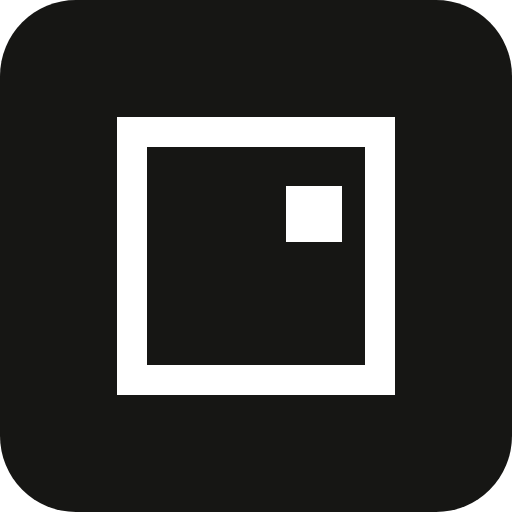
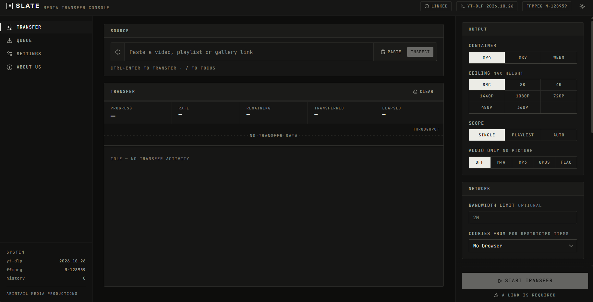
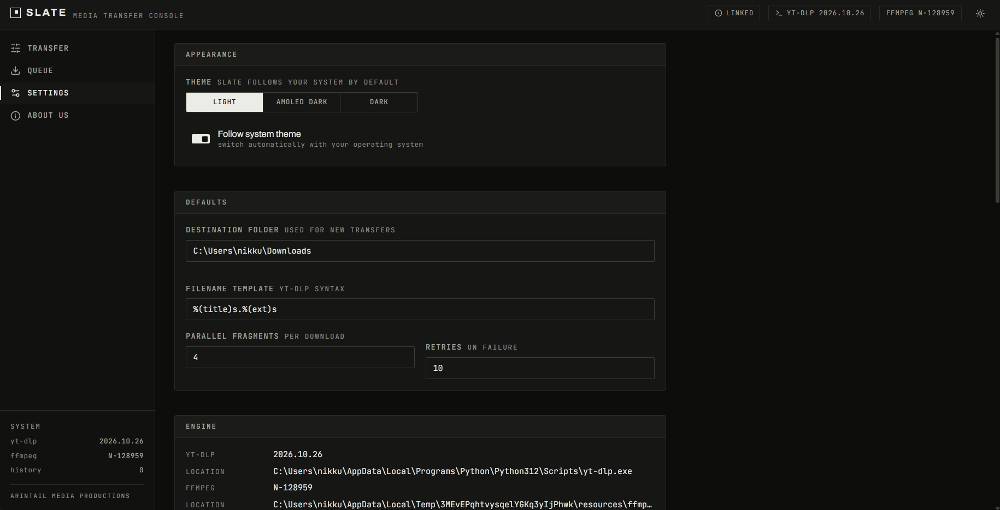
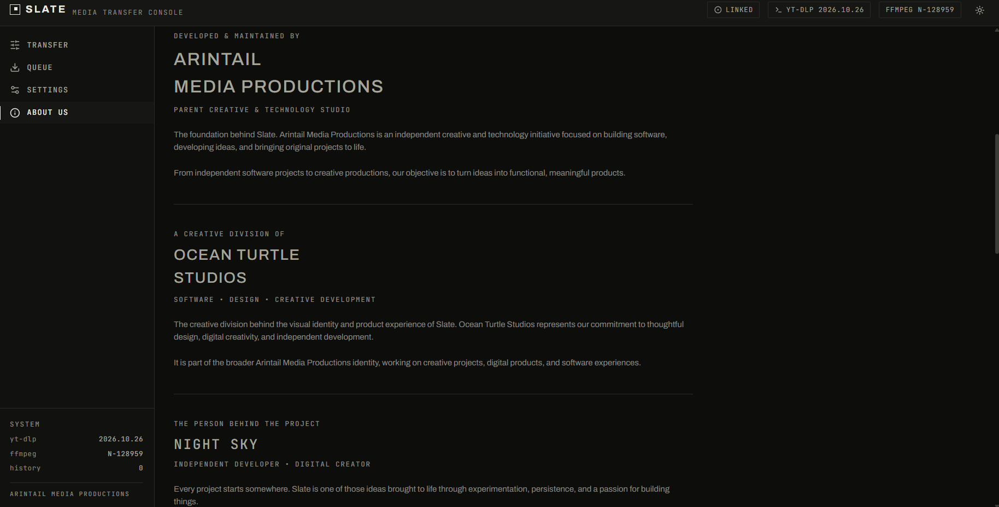
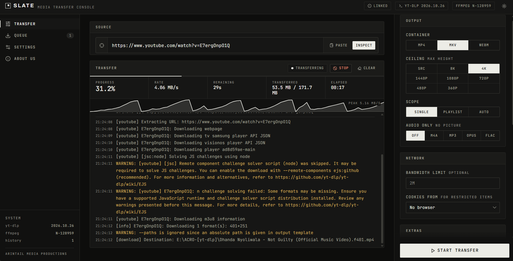

# SLATE

  

  <strong>MEDIA TRANSFER CONSOLE</strong> 
  Powered by yt-dlp &amp; FFmpeg

  
  
  
  

Slate is an independent Windows media transfer application designed to provide a focused and straightforward workspace for media retrieval and processing.

Developed by **Arintail Media Productions**, with **Ocean Turtle Studios**.

---

## Application Preview

*Transfer interface — paste a link, set your options, start the transfer.*

*Download queue — track every transfer in real time.*

*Settings — formats, engines, destinations, and appearance.*

*About Us — studio branding, credits, and support.*

---

## Features

- Media URL processing for individual videos and playlists.
- Video and audio download modes.
- Format and resolution selection, including source quality and 8K.
- Download queue with live progress, speed, and ETA.
- Configurable settings: destination, filename template, containers, fragments, retries, subtitles, metadata, and more.
- Light, dark, and AMOLED dark themes.
- Desktop interface powered by a local API and Server-Sent Events.
- yt-dlp integration for media retrieval.
- FFmpeg integration for muxing and processing.
- Managed engine installers for yt-dlp and FFmpeg, with manual install instructions as a fallback.

---

## Download Slate

Get the latest release from:

**https://github.com/NIGHT-SKY-DEV/Slate-Media-Downloader/releases/latest**

### Available distributions

- **Windows Installer** — recommended for standard installation.
- **Windows Portable Executable** — run Slate without a conventional installation.
- **Windows ZIP** — extract and run manually.

### Installation

**Installer**
1. Download the Setup executable.
2. Run the installer.
3. Follow the installation instructions.
4. Launch Slate.

**Portable**
1. Download the portable executable.
2. Place it in a suitable folder.
3. Launch Slate.

**ZIP**
1. Download the ZIP archive.
2. Extract its contents.
3. Launch the application using the included executable.

### Runtime requirements

- Windows 10 or later (x64).
- yt-dlp and FFmpeg are bundled/installed by Slate. No separate runtime is required.

---

## Studio

**DEVELOPED BY**

NIGHT SKY

ARINTAIL MEDIA PRODUCTIONS

**A CREATIVE DIVISION OF**

OCEAN TURTLE STUDIOS

Instagram: https://www.instagram.com/oceanturtle.studios/

---

## Support

Slate is free to use. Contributions are entirely optional and help support
continued development, maintenance, and improvements.

Support options are available inside the application on the **About Us** page.

---

## Third-party software

Slate uses **yt-dlp** for media retrieval and **FFmpeg** for media processing.
These are independent projects with their own licenses.

- yt-dlp — https://github.com/yt-dlp/yt-dlp
- FFmpeg — https://ffmpeg.org/

See `THIRD-PARTY-NOTICES.md` for licensing details.

---

## License

Slate is proprietary software distributed free of charge under the **Arintail Free Use License (AFUL-1.0)**. It is not open source. See `LICENSE.txt` for the full terms and `THIRD-PARTY-NOTICES.md` for third-party acknowledgements.

---

## Footer

WE ARE PARASITES.

© 2026 ARINTAIL MEDIA PRODUCTIONS

AN OCEAN TURTLE STUDIOS PROJECT.
